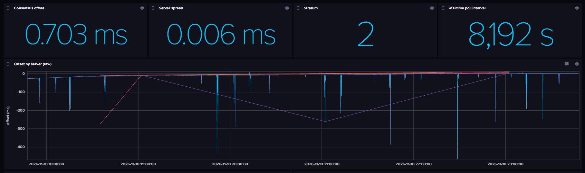
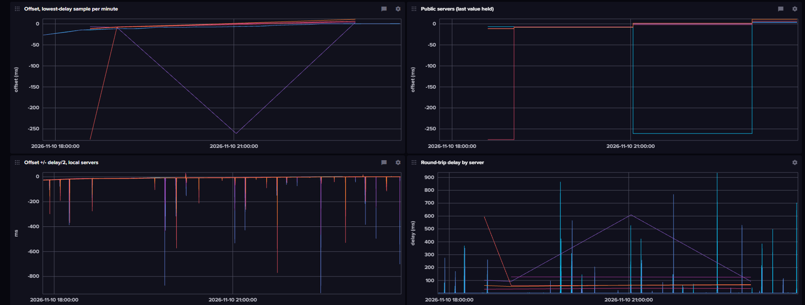
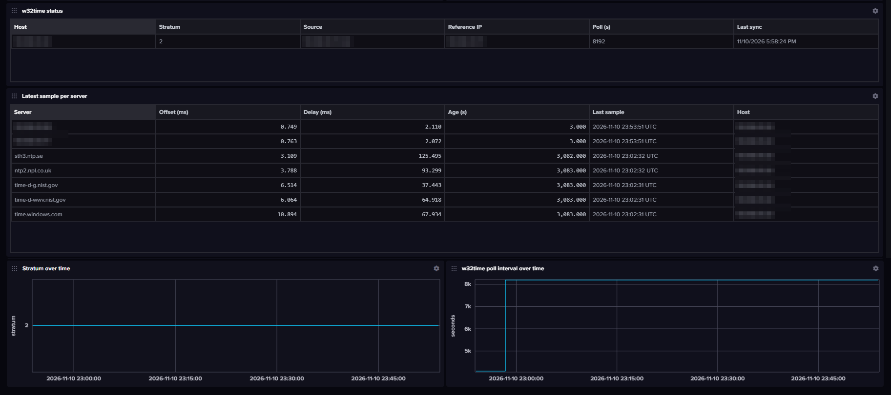

# TimeMonitor

A test program from 2022. Windows keeps its clock in sync with w32time, but gives little sign of how accurate the clock actually is. TimeMonitor measures it: it compares the PC's clock with several NTP servers, local and public, records the results in InfluxDB, and comes with an InfluxDB dashboard that shows drift, network noise and how far the clock can be trusted. It needs only Python and Windows' own `w32tm` tool, plus the `influxdb-client` package for InfluxDB output.

Every few seconds it:

- Reads the local Windows Time service status (`w32tm /query /status`): stratum, reference ID, reference IP, last successful sync, source and poll interval.
- Measures offset and round-trip delay to a list of NTP servers (`w32tm /stripchart`): each at its own interval, set in `config.ini`.
- Writes both to InfluxDB 2.x for graphing in Grafana or the InfluxDB UI.

## Limitations

This was just a test program, published for reference. It has been tidied up, but not redesigned.

- It reads `w32tm` output by looking for English labels such as `Stratum:` and `d:`. On Windows set to another display language, the readings will fail.
- `resync_time()` does not work, and the resync check is commented out.

## Requirements

- Windows (uses `w32tm`)
- Python 3
- For InfluxDB output only: `pip install influxdb-client`, an InfluxDB 2.x bucket, and a token with write access to that bucket. Write access is tied to the bucket itself, so if you delete and recreate the bucket, give the token write access to the new one

## Configuration

Copy `config.example.ini` to `config.ini` and edit it:

- `[monitor]` `loop_seconds`: how often the w32time status is read.
- `[servers]`: one `server = seconds` line per NTP server to poll. The first is your primary (local) server. Poll public servers sparingly (7200 s or more).
- `[influxdb]`: connection settings. Leave `token` empty to print results to the console only.

`config.ini` is ignored by git, so your token stays local. The `INFLUX_URL`, `INFLUX_ORG`, `INFLUX_BUCKET` and `INFLUX_TOKEN` environment variables override the file. Without a `config.ini`, the program runs with `config.example.ini`.

## Running

```
python TimeMonitor.py
```

Or open `TimeMonitor.slnx` in Visual Studio and press F5. Stop with Ctrl+C.

## Data written to InfluxDB

Only successful readings are written. A failed `w32tm` call or InfluxDB write is printed to the console, and the program carries on.

**Measurement:** the PC's IPv4 address, for example `192.168.1.25`. It is the local address the PC uses to reach the first server in `[servers]`, so each monitored PC gets its own measurement. If the PC's address changes (DHCP, another network), new data goes to a new measurement.

**Timestamps:** the wall-clock time each reading was taken, in nanoseconds. Each server sample has its own timestamp.

### w32time status

Written every loop (`loop_seconds`), from `w32tm /query /status`. No tags.

| Field | Type | Example | Meaning |
|---|---|---|---|
| `Stratum` | integer | `3` | Stratum of the Windows clock: one more than the stratum of the server it syncs from. `1` with source `Local CMOS Clock` means it is not syncing to anything. |
| `ReferenceID` | string | `C0A8010A` | Reference ID in hex, without `0x`. For an NTP source it is the server's IPv4 address in hex (`C0A8010A` = 192.168.1.10). For a local clock it is ASCII, e.g. `4C4F434C` = "LOCL". |
| `ReferenceIP` | string | `192.168.1.10` | IP address of the source w32time syncs from. Empty when the source is a local clock. |
| `LastSync` | string | `11/10/2026_9:40:12_AM` | Last successful sync, as Windows prints it in the PC's date format, with spaces changed to `_`. `unspecified` if it has never synced. |
| `Source` | string | `192.168.1.10-0x9` | w32time's configured source, with commas changed to `-`. The `0x…` part is the peer's w32time mode flags. |
| `PollInterval` | integer | `6` | w32time poll interval as a power of two (2^6 = 64 s). |
| `PollSeconds` | integer | `64` | The same poll interval in seconds. |

The strings are stored for reference; they are not meant for graphing.

### NTP server samples

Written for each server in `[servers]` at its own interval, from `w32tm /stripchart /samples:1`. The interval is rounded to a whole number of loops.

| Tag or field | Type | Example | Meaning |
|---|---|---|---|
| `ReferenceNTPServer` (tag) | string | `time.google.com` | The server sampled, exactly as written in `config.ini`. Use it to filter or group by server. |
| `Offset_s` | float | `-0.0021345` | Offset between this PC's clock and the server, in seconds, as reported by `w32tm` (`o:`). |
| `Delay_s` | float | `0.0324567` | Round-trip network delay to the server, in seconds (`d:`). Large or varying delay makes the offset less reliable. |

If every server shows about the same offset, the PC's own clock is off. If one server disagrees with the rest, that server (or the path to it) is the likely problem.

### Example query (Flux)

Offset to every server, one line per server:

```
from(bucket: "ClockMetrics")
  |> range(start: v.timeRangeStart, stop: v.timeRangeStop)
  |> filter(fn: (r) => r._measurement == "192.168.1.25" and r._field == "Offset_s")
  |> group(columns: ["ReferenceNTPServer"])
```

In the Data Explorer's query builder, choose the measurement and `Offset_s`, then change the next filter's key from `_field` to `ReferenceNTPServer`.

## Dashboard

`influxdb/TimeMonitor-dashboard.json` is an InfluxDB 2.x dashboard for this data. To import it: **Dashboards → Create Dashboard → Import Dashboard**, then choose the file. Or, with the `influx` CLI: `influx apply -f influxdb/TimeMonitor-dashboard.json`. Importing always creates a new dashboard; to update one, delete the old dashboard first.

Set the time range longer than your slowest server's poll interval (for example 3 h when public servers are polled every 7200 s), or those servers will be missing from the graphs and the latest-sample table. The queries use the bucket `ClockMetrics`; if yours has another name, change it in each cell.

The dashboard assumes one monitored PC per bucket. The graphs label lines by server only, so two PCs measuring the same server would share a line.

### Layout, top to bottom



**Summary row**

- **Consensus offset:** the median of the latest offset from each server sampled in the last 10 minutes. This is the best single answer to "how far off is this PC's clock?". Older samples are left out because the clock keeps drifting after they were taken.
- **Server spread:** the largest minus the smallest of those same offsets. Small means the servers agree; large points to a bad server or network path.
- **Stratum:** the Windows clock's current stratum. `1` with source `Local CMOS Clock` means Windows is not syncing to anything.
- **w32time poll interval:** how often Windows Time currently corrects the clock.

**Offset by server (raw):** every sample from every server, in ms. Shows the true picture, noise included.



**Offset, lowest-delay sample per minute:** for each server, only the sample with the smallest round-trip delay in each minute. A sample that took longer is more likely to have been delayed one way more than the other, which shows up as a false offset. Picking the fastest sample is the same idea NTP uses to filter its samples. Read the clock's behavior from this graph.

**Public servers (last value held):** servers with public addresses. They are sampled rarely, so each value is drawn as a step that holds until the next sample.

**Offset +/- delay/2, local servers:** for servers with private addresses (10.x, 172.16–31.x, 192.168.x), three lines each: the offset, and the offset minus and plus half the round-trip delay. The program cannot tell how the delay splits between the trip out and the trip back, so the true offset lies somewhere between the low and high lines. That range is how far the clock can be trusted.

**Round-trip delay by server:** network delay in ms. Use it to explain spikes in the raw offset graph.



**w32time status:** the latest Windows Time status for the PC: stratum, source, reference IP, poll interval and last successful sync.

**Latest sample per server:** one row per server with its latest offset, delay, and age in seconds. A server with a large age, or no row, has stopped answering (or is polled less often than the time range).

**Stratum over time** and **w32time poll interval over time:** step graphs of Windows Time's state. A change in stratum means Windows switched source or lost sync. The poll interval grows while Windows thinks the clock is stable.

### Reading it

- **All servers drift at the same rate:** the system clock is drifting, not the servers. Independent servers are highly unlikely to all drift together, so the common movement is almost certainly the PC's own clock (but see below). The slope is the drift rate: 1 ms per minute is about 17 ppm. A long w32time poll interval lets the drift build up between corrections.
- **One server disagrees with the rest:** that server, or the network path to it, is the problem, not the PC.
- **A sharp spike in the raw offset at the same moment as a delay spike:** network delay, not the clock. It should be gone from the lowest-delay graph.
- **The offset jumps and the stratum or source changes at the same time:** Windows Time switched source or stepped the clock.
- **All servers shift together, but round-trip delay rises at the same time:** suspect the network path, not the clock. See below.

### When every server moves together

Other things besides the PC's clock can make every server move together:

- **Delay attacks:** someone on the network path between the PC and the servers holds back packets in one direction. Every server's offset shifts by up to half the added delay.
- **Spoofed replies:** `w32tm /stripchart` uses unauthenticated NTP, so an attacker on the path could also answer for the servers with any time they like.
- **Innocent causes of the same pattern:** a VPN switching on, a congested upload link, or a route change that makes the shared first part of the path (Wi-Fi, dock, ISP) uneven.

How to tell them apart:

- A delay-based shift also raises the round-trip delay, and it cannot move the offset outside the ±delay/2 band. Real clock drift moves the offset while the delay stays flat.
- A local, GPS-disciplined server on the same LAN is hard to influence from outside, so if it agrees with the public servers, the shift is real.

## License

GNU General Public License v3.0 only (GPL-3.0-only). See [LICENSE](LICENSE).
